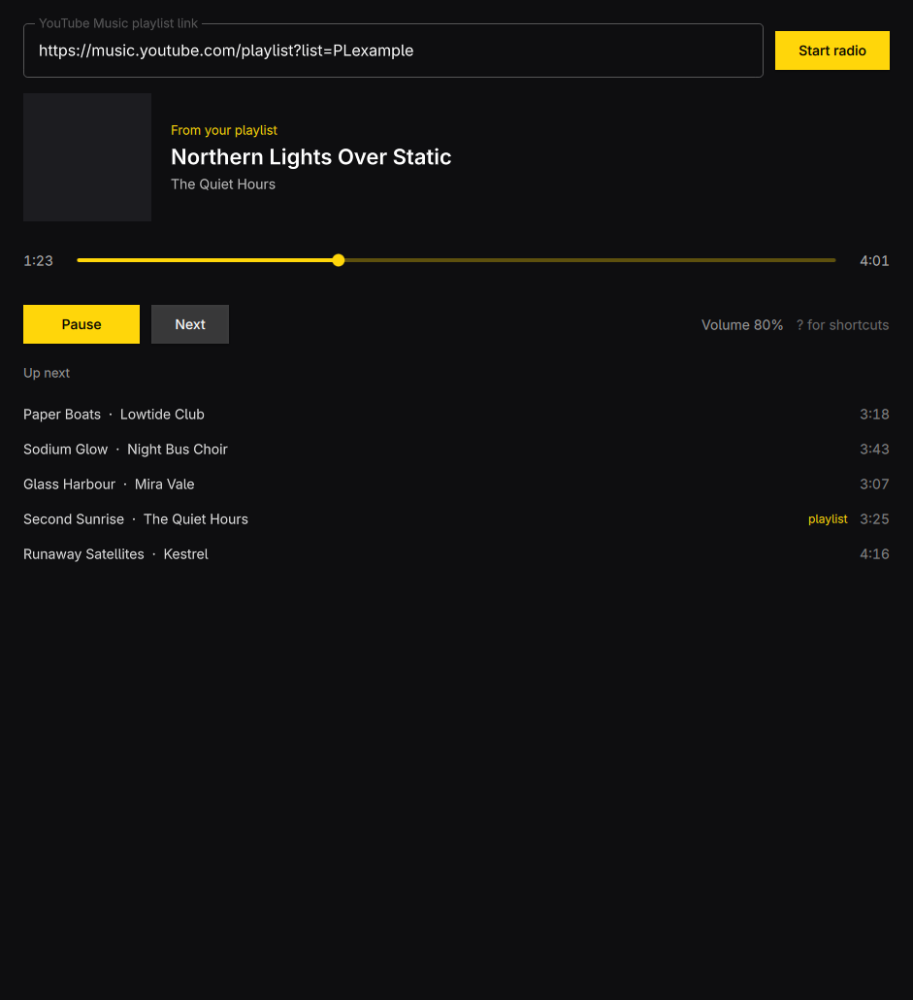

# Drift



Endless YouTube Music radio from one of your playlists. Paste a playlist link
and Drift takes each song from it in turn, plays it, then plays a few tracks
from YouTube Music's radio for that song, and keeps going forever. Playlist
songs come back after every pass; nothing else repeats.

Or type a song name instead of a link: Drift searches YouTube Music, and the
song you pick starts an endless radio of similar songs that keeps moving from
one related mix to the next.

Audio plays through `mpv` with video off and a small buffer, and `yt-dlp`
reads the playlist, so the whole thing stays around 200 MB.

## Shortcuts

| Key | Action |
| --- | --- |
| Space | Play or pause |
| N | Next track |
| ← → | Seek 10 seconds |
| ↑ ↓ | Volume |
| Enter | Search, or play the picked song |
| Ctrl+L | Search or change playlist |
| Esc | Close search results, leave the field |
| ? | Show shortcuts |
| Q | Quit |

## In the background

Close the window while music plays and Drift keeps playing with its window
and interface unloaded; launch it again to bring the window back. Q quits.
Closing the window with nothing playing quits too.

On Linux Drift is an MPRIS player, so the keyboard's media keys, `playerctl`,
and Omarchy's media bar widget play, pause, and skip without switching to it.
On Windows the media keys and the media flyout do the same.

## Build

```sh
bin/build      # build/drift
bin/test       # Qt Test, offscreen
bin/install    # makepkg -fsi, adds Drift to the app launcher
```

Needs `mpv` and `yt-dlp`. The playlist must be public or unlisted.

## Windows

The `Release` GitHub Actions workflow builds `Drift-setup-x64.exe`, an
installer that needs no admin rights and adds Drift to the Start menu, and
`Drift-windows-x64.zip`, the same files to unzip anywhere. Both bundle
`mpv.exe` and `yt-dlp.exe` beside `drift.exe`. Run it from the Actions tab,
or push a `v*` tag to attach both to a release. Drift follows the Windows
display language. The installer script is `windows/drift.iss`.
The same tag also gets the Arch package (`drift-<version>-x86_64.pkg.tar.zst`);
keep `pkgver` in `pkgbuild/PKGBUILD` in step with the tag.

To build by hand: Qt 6.8 for MSVC, then `qmake CONFIG-=debug_and_release
drift.pro && nmake`, `windeployqt --qmldir src drift.exe`, and put `mpv.exe`
and `yt-dlp.exe` in the same folder (or on `PATH`).
